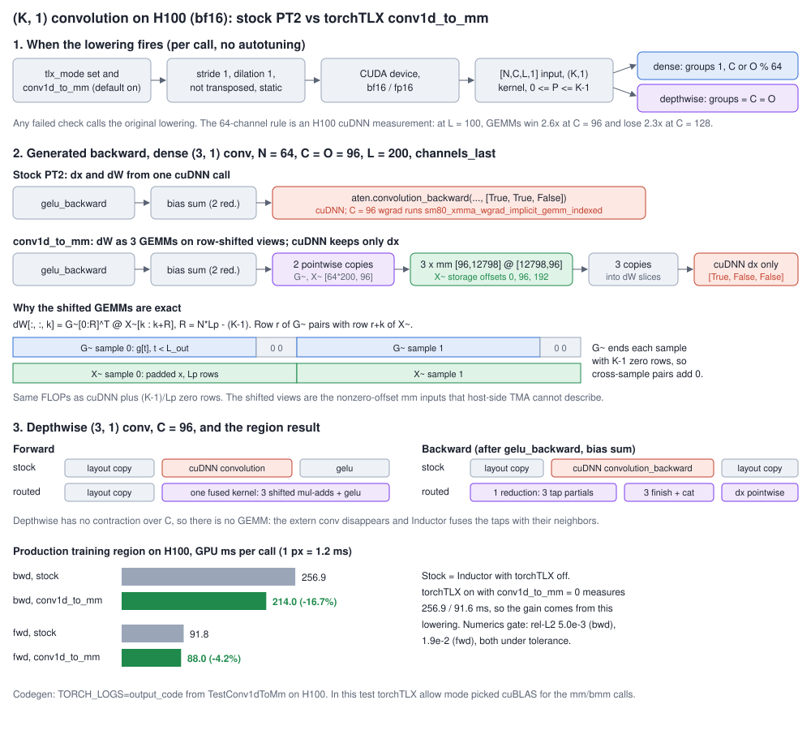

# Why conv1d_to_mm wins: (K, 1) convolutions on H100

This note explains `tlx_config.conv1d_to_mm`. It replaces Inductor's lowering of
`aten.convolution` and `aten.convolution_backward` for eligible `(K, 1)`
convolutions. It compares stock PT2 (`triton.tlx_mode=None`) with torchTLX
(`triton.tlx_mode="allow"`) on H100, bf16.

## Summary

The lowering changes no FLOPs and no algorithm. On H100, cuDNN runs the weight
grad of a dense `(K, 1)` conv off 64-channel multiples (C = 96, for example)
on the slow `sm80_xmma_wgrad_implicit_gemm_indexed` kernel. The same sum is K
plain GEMMs, and Inductor's `mm` path runs those near the hardware limit. At
C = 128, cuDNN picks a fast kernel and wins by 2.3x, so the lowering does not
fire there. Depthwise convs have no contraction over C, so they become shifted
multiply-adds that Inductor fuses with their neighbors.

On a production training region on H100, the backward drops from 256.9 ms to
214.0 ms per call (-16.7%), and the forward drops from 91.8 ms to 88.0 ms.
torchTLX on with `conv1d_to_mm=0` measures 256.9 / 91.6 ms, so the whole gain
comes from this lowering.



## The math

Input `x` is `[N, C, L, 1]`, weight `W` is `[O, C, K, 1]` and grad `g` is
`[N, O, L_out, 1]`. `x^` is `x` padded by P on each side of L, so
`Lp = L + 2P` and `L_out = Lp - K + 1`.

```
forward  y[n,o,t]  = b[o] + sum_k sum_c W[o,c,k] * x^[n,c,t+k]
wgrad    dW[o,c,k] = sum_n sum_t g[n,o,t] * x^[n,c,t+k]
dgrad    dx[n,c,u] = sum_o sum_k W[o,c,k] * g[n,o,u+P-k]
```

Flatten `(n, t)` into one row index. `G~` is `g` padded to Lp rows per sample
with K-1 zero rows at the end, as `[N*Lp, O]`. `X~` is `x^` as `[N*Lp, C]`.
Then

```
dW[:, :, k] = G~[0:R]^T @ X~[k : k+R],   R = N*Lp - (K-1)
```

The result is exact. A real row of `G~` (t < L_out) pairs with a row of the
same sample, because t + k <= Lp - 1. Pairs that cross a sample boundary start
from the zero rows. The K GEMMs share `G~` and read `X~` through shifted views,
so no im2col copy is needed.

For K = 1, the input grad is a GEMM too: `dx[n] = W^T @ g[n]`, a `bmm` over N.

## When it fires

`_params()` decides per call, with no autotuning against cuDNN:

| Check | Condition |
|---|---|
| Switch | `triton.tlx_mode` set and `tlx_config.conv1d_to_mm` (`TORCHINDUCTOR_TLX_CONV1D_TO_MM`, default on) |
| Conv type | not transposed, stride 1, dilation 1, zero output padding |
| Shapes | static 4-D sizes, `[N, C, L, 1]` input, `(K, 1)` kernel, width padding 0, `0 <= P <= K-1` |
| Device | CUDA, bf16 or fp16 |
| Dense | groups 1 and `C % 64 or O % 64` |
| Depthwise | groups = C = O |

What each path rewrites:

| Computation | Dense | Depthwise |
|---|---|---|
| forward | cuDNN (unchanged) | shifted multiply-add, fused |
| wgrad | K `mm` + `cat` | K reductions + `cat` |
| dgrad | K = 1: `bmm`; K > 1: cuDNN with mask `[True, False, False]` | flipped shifted multiply-add |
| bias grad | fp32 channel sum | fp32 channel sum |

## Generated code

From `TORCH_LOGS=output_code` on `TestConv1dToMm` (H100). In these tests
torchTLX `allow` mode picked cuBLAS for the `mm`/`bmm` calls.

Dense `(3, 1)` conv, N = 64, C = O = 96, L = 200, channels_last, backward:

```python
# stock PT2
triton_poi_fused_gelu_backward_0.run(...)
triton_red_fused_convolution_backward_1.run(...)        # bias sum
triton_red_fused_convolution_backward_2.run(...)
buf3 = torch.ops.aten.convolution_backward.default(buf0, primals_3, primals_2, [96], ..., 1, [True, True, False])

# conv1d_to_mm
triton_poi_fused_gelu_backward_0.run(...)
triton_red_fused_convolution_backward_1.run(...)        # bias sum
triton_red_fused_convolution_backward_2.run(...)
triton_poi_fused_convolution_backward_3.run(buf0, buf3, ...)        # G~ [64*200, 96]
triton_poi_fused_convolution_backward_4.run(primals_3, buf4, ...)   # X~ [64*200, 96]
extern_kernels.mm(reinterpret_tensor(buf3, (96, 12798), (1, 96), 0), reinterpret_tensor(buf4, (12798, 96), (96, 1), 0), out=buf5)
extern_kernels.mm(reinterpret_tensor(buf3, (96, 12798), (1, 96), 0), reinterpret_tensor(buf4, (12798, 96), (96, 1), 96), out=buf6)
extern_kernels.mm(reinterpret_tensor(buf3, (96, 12798), (1, 96), 0), reinterpret_tensor(buf4, (12798, 96), (96, 1), 192), out=buf7)
triton_poi_fused_convolution_backward_5.run(buf5, buf8, ...)        # x3: into dW[:, :, k]
buf12 = torch.ops.aten.convolution_backward.default(buf0, primals_3, primals_2, [96], ..., 1, [True, False, False])
```

The shifted views of `X~` are `mm` inputs with storage offsets 0, 96 and 192.
A torchTLX GEMM template must build their TMA descriptors on the device,
because a host descriptor cannot carry a storage offset.

Dense `(1, 1)` conv (K = 1): no cuDNN call is left. `G~` is written by the
`gelu_backward` kernel itself, then one `mm` gives dW and one `bmm` gives dx.

Depthwise `(3, 1)` conv, C = 96:

| Graph | Stock PT2 | conv1d_to_mm |
|---|---|---|
| forward | layout copy, `extern_kernels.convolution`, gelu | layout copy, one kernel for the 3 taps and gelu |
| backward | layout copy, `aten.convolution_backward`, layout copy | one reduction for the 3 tap partials, 3 finishing reductions, dW copy, dx pointwise |

## Limits

- The 64-channel rule and every number here come from H100 with one cuDNN
  version. The gate does not check the architecture.
- Symbolic sizes fall back to the original lowering.
- The dense wgrad writes padded, permuted copies of `x` and `g` before the
  GEMMs. This extra traffic pays off only while cuDNN is on its slow path.
