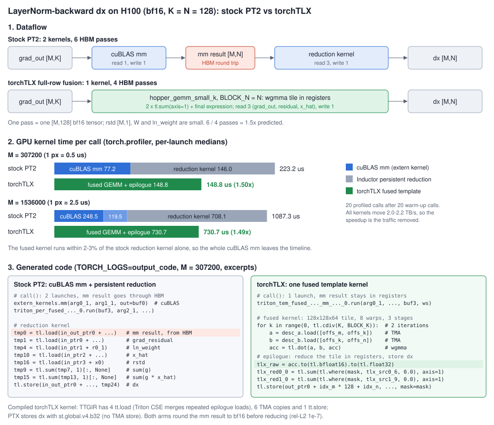

# Why the sm90 row-reduction epilogue wins: LayerNorm-backward dx

This note explains the `sm90_08_mm_layernorm_bwd` fusion-bench result for the
torchTLX row-reduction epilogue on the sm90 small-K GEMM template
(`hopper_gemm_small_k`). It compares stock PT2 (`triton.tlx_mode=None`) with
torchTLX (`triton.tlx_mode="allow"`) on H100, bf16, K = N = 128.

## Summary

The torchTLX arm replaces stock PT2's cuBLAS mm plus persistent-reduction
kernel with one TLX template kernel. That kernel runs within 2-3% of the stock
reduction kernel alone, so the whole cuBLAS mm leaves the timeline. All kernels
in both arms move data at about 2.1-2.2 TB/s. The speedup is therefore the HBM
traffic removed: 6 full-tensor passes become 4, which predicts 1.5x.

| M | Kineto GPU time, stock | Kineto GPU time, torchTLX | Speedup | rel-L2 vs stock |
|---|---|---|---|---|
| 307200 | 223.2 us | 148.8 us | 1.50x | 1.0e-07 |
| 1536000 | 1087.3 us | 730.7 us | 1.49x | 2.3e-11 |

The `do_bench` wall-clock speedups from the fusion bench (1.479x and 1.488x)
agree with kineto within 3%, so the win is not a launch-overhead effect.



## The fused math

The bench model is the input-gradient half of LayerNorm backward:

```python
dy = mm(grad_out, W) + grad_residual   # projection dgrad + residual, [M, N]
g = dy.float() * ln_weight.float()      # gamma, [N]
dx = rstd * (g - g.mean(-1, keepdim=True) - x_hat * (g * x_hat).mean(-1, keepdim=True))
```

`rstd` is an `[M, 1]` row input and `x_hat` is an `[M, N]` tile input. The two
means are row reductions over N. `dgamma` and `dbeta` (column reductions) are
not part of this bench.

## Kineto: per-kernel GPU time

Per-launch medians, 20 profiled calls after 20 warm-up calls.

| M | Arm | Kernel | Launches per call | Median us | Grid x block | Regs | Smem (B) |
|---|---|---|---|---|---|---|---|
| 307200 | stock | `nvjet_tst_128x160_64x5_1x2_h_bz_NNT` (cuBLAS) | 1 | 77.2 | (2,66,1) x 384 | 168 | 200924 |
| 307200 | stock | `triton_per_fused__to_copy_add_mean_mul_sub_0` | 1 | 146.0 | 38400 x 64 | 56 | 256 |
| 307200 | torchTLX | `triton_tem_fused__to_copy_add_mean_mm_mul_sub_0` | 1 | 150.0 | 2400 x 256 | 128 | 98328 |
| 1536000 | stock | `nvjet_tst_128x288_64x4_1x2_h_bz_coopA_NNT` (cuBLAS) | 2 | ~248.5 + ~119.5 | (2,66,1) x 384 | 168 | 229540 |
| 1536000 | stock | `triton_per_fused__to_copy_add_mean_mul_sub_0` | 1 | 708.1 | 192000 x 64 | 56 | 256 |
| 1536000 | torchTLX | `triton_tem_fused__to_copy_add_mean_mm_mul_sub_0` | 1 | 731.6 | 12000 x 256 | 128 | 98328 |

Stock also launches a sub-microsecond `Memset (Device)` per cuBLAS call. At
M = 1536000 cuBLAS issues two `nvjet` launches per `extern_kernels.mm` call;
the reason was not investigated.

Where the time went:

| M | cuBLAS mm removed | Fused kernel minus stock reduction kernel | Net saved |
|---|---|---|---|
| 307200 | -77.2 us | +2.8 us (+1.9%) | -74.4 us |
| 1536000 | -368 us | +22.6 us (+3.2%) | -356.6 us |

With K = 128 the GEMM has only two `BLOCK_K = 64` steps, so its cost hides
under the memory traffic that the epilogue needs anyway.

## Bandwidth cross-check

One pass is one `[M, 128]` bf16 tensor: 78.6 MB at M = 307200 and 393.2 MB at
M = 1536000. `rstd` adds 1.2 MB and 6.1 MB. Bandwidth is minimum traffic
divided by kineto time; these are effective rates, not DRAM counters. H100 SXM
HBM3 peak is about 3.35 TB/s.

| Kernel | HBM traffic | M = 307200 | M = 1536000 |
|---|---|---|---|
| cuBLAS mm | read grad_out, write mm result (2 passes) | 157 MB / 77.2 us = 2.04 TB/s | 786 MB / 368 us = 2.14 TB/s |
| stock reduction | read mm result, grad_residual, x_hat, rstd; write dx (4 passes) | 316 MB / 146.0 us = 2.16 TB/s | 1579 MB / 708.1 us = 2.23 TB/s |
| torchTLX fused | read grad_out, grad_residual, x_hat, rstd; write dx (4 passes) | 316 MB / 148.8 us = 2.12 TB/s | 1579 MB / 730.7 us = 2.16 TB/s |

All three kernels run at 61-67% of HBM peak. The fused kernel moves the same
bytes as the stock reduction kernel at nearly the same rate.

## Codegen comparison

Wrapper `call()`, stock PT2 (M = 307200):

```python
buf0 = empty_strided_cuda((307200, 128), (128, 1), torch.bfloat16)
extern_kernels.mm(arg0_1, arg1_1, out=buf0)  # cuBLAS
buf3 = buf0; del buf0  # reuse
triton_per_fused__to_copy_add_mean_mul_sub_0.run(buf3, arg2_1, arg3_1, arg4_1, arg5_1, 307200, 128, ...)
return (buf3, )
```

Wrapper `call()`, torchTLX (M = 307200):

```python
buf3 = empty_strided_cuda((307200, 128), (128, 1), torch.bfloat16)  # dx, the only [M, N] buffer
workspace_12 = empty_strided_cuda((33792, ), (1, ), torch.uint8)  # TMA descriptors
triton_tem_fused__to_copy_add_mean_mm_mul_sub_0.run(arg0_1, arg1_1, arg2_1, arg3_1, arg4_1, arg5_1, buf3, workspace_12, 2400, 1, 1, ...)
return (buf3, )
```

Stock reduction kernel body (excerpt):

```python
tmp0 = tl.load(in_out_ptr0 + (r0_1 + 128*x0), ...)   # mm result, read from HBM
tmp1 = tl.load(in_ptr0 + (r0_1 + 128*x0), ...)       # grad_residual
tmp4 = tl.load(in_ptr1 + (r0_1), ...)                # ln_weight
tmp10 = tl.load(in_ptr2 + (r0_1 + 128*x0), ...)      # x_hat
tmp16 = tl.load(in_ptr3 + (x0), ...)                 # rstd
tmp9 = tl.sum(tmp7, 1)[:, None]                      # sum(g)
tmp15 = tl.sum(tmp13, 1)[:, None]                    # sum(g * x_hat)
tl.store(in_out_ptr0 + (r0_1 + 128*x0), tmp24, None) # dx
```

torchTLX fused kernel body (excerpt; 128x128x64 tile, 8 warps, 3 stages):

```python
acc = tl.zeros((BLOCK_M, BLOCK_N), dtype=tl.float32)
for k in range(0, tl.cdiv(K, BLOCK_K)):          # 2 iterations
    a = desc_a.load([offs_m, offs_k])             # TMA
    b = desc_b.load([offs_k, offs_n])             # TMA
    acc = tl.dot(a, b, acc)                       # wgmma
tlx_raw = acc.to(tl.bfloat16).to(tl.float32)      # mm result stays in registers
tlx_red0_0 = tl.sum(tl.where(mask, tlx_src0_6, 0.0), axis=1)[:, None]
tlx_red1_0 = tl.sum(tl.where(mask, tlx_src1_9, 0.0), axis=1)[:, None]
tlx_v0 = tl.load(in_ptr5 + (idx_m) * (1), ...)    # rstd row input
tl.store(out_ptr0 + (idx_m) * 128 + (idx_n), tlx_v21.to(tl.bfloat16), mask=mask)
```

| Property | Stock PT2 | torchTLX |
|---|---|---|
| Kernels per call | 2 (3 at M = 1536000) | 1 |
| mm result in HBM | yes, written then re-read | no, registers only |
| Stores | 1 pointer `tl.store` (dx) | 1 pointer `tl.store` (dx); PTX `st.global.v4.b32`, no TMA store |
| Global loads, Triton source | 5 | 9, plus TMA loads for A and B |
| Global loads, compiled TTGIR | - | 4 `tt.load`, 6 `async_tma_copy_global_to_local`, 1 `tt.store` |
| Rows per CTA | 8 (2 warps) | 128 (8 warps) |

The epilogue emitter writes each subexpression per use, so the Triton source
loads `grad_residual` and `ln_weight` three times and `x_hat` twice. Triton's
CSE merges them: the compiled TTGIR has one `tt.load` per input.

Both arms round the mm result to bf16 before the reductions. Stock does so
because the cuBLAS output is a bf16 tensor. The fused kernel does the same
(`tlx_raw`) to match stock, which keeps rel-L2 at 1e-7.

## Observations

- The fused tile was 128x128x64 at both shapes in this run; another run picked
  a 64x128 tile at M = 307200. Both are full-row (`BLOCK_N = N = 128`) and their
  timings agree.
- This covers the `dx` core only. A full LayerNorm backward also needs `dgamma`
  and `dbeta`.

## Method

- Both arms compile the bench model with `torch.compile`; only
  `triton.tlx_mode` differs.
- Kernel times come from `torch.profiler` (CPU and CUDA activities), 20 calls
  after 20 warm-up calls.
- Code listings come from `TORCH_LOGS=output_code`. The TTGIR and PTX counts
  come from the compiled kernel in the Inductor cache.
