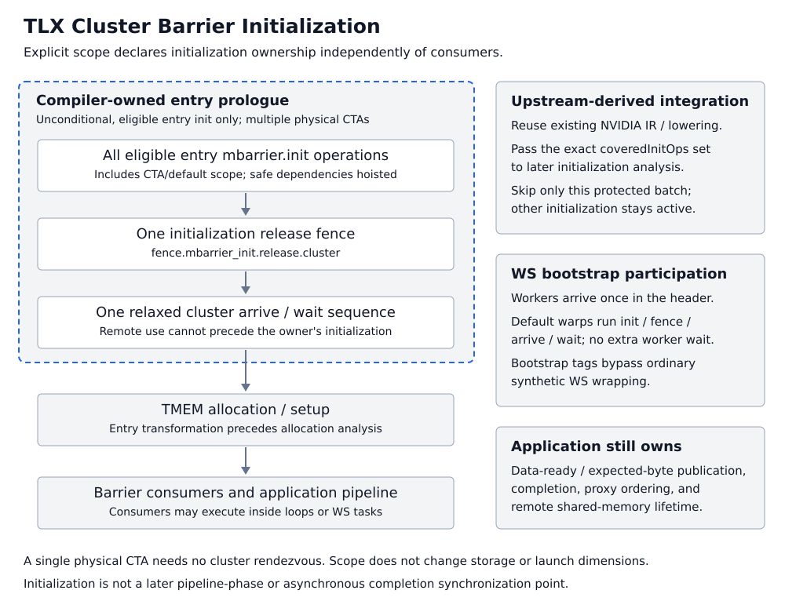

## Barriers

> For the concepts behind these calls — asynchronous barrier semantics, the
> mbarrier phase model, named vs memory barriers, and producer-consumer
> patterns — see
> [Barrier Support in TLX](third_party/tlx/doc/tlx_barriers.md).

- `barriers = tlx.alloc_barriers(num_barriers, arrive_count=1, scope="cta")` **[sm90+]**

    Allocates buffer in shared memory and initialize mbarriers with arrive_counts.

    Input:
    - `num_barriers`: The number of barriers to allocate.
    - `arrive_count`: The number of threads that need to arrive at the barrier before it can be released.
    - `scope`: Compile-time initialization scope, `"cta"` or `"cluster"`.

    Use `scope="cluster"` for barriers that require cross-CTA initialization
    visibility. With multiple physical CTAs, if any eligible kernel-entry
    barrier has cluster scope, the compiler batches all eligible entry barrier
    initializations, including CTA-scoped barriers, before TMEM allocation.
    Immediately after the last
    initialization it inserts one initialization fence followed by a relaxed
    cluster arrive and cluster wait, independently of which operations consume
    the barriers. This works with either logical multi-CTA distribution or a
    physical multi-CTA cluster. A single physical CTA needs no cluster
    rendezvous; scope never changes the launch dimensions or barrier layout.

    Allocate cluster-scoped barriers unconditionally in the kernel prologue,
    before their use. Consumers may be inside loops or warp-specialized tasks,
    but initializing these barriers inside branches, loops, or tasks is not
    supported. The default preserves existing behavior, including legacy
    compiler synchronization for recognized paired-MMA and other consumers.

    ```python
    # Requires a two-CTA launch; scope does not create the cluster.
    bars = tlx.alloc_barriers(num_barriers=1, scope="cluster")
    # Initialization is ready for cross-CTA use; no manual init fence is needed.
    if tlx.cluster_cta_rank() == 0:
        tlx.barrier_arrive(bar=bars[0], remote_cta_rank=1)
    ```

    Initialization scope does not change `arrive_count`, register expected
    transaction bytes, or wait for asynchronous completion. Keep data-ready
    handshakes, proxy fences, and DSM lifetime synchronization required by the
    algorithm. The automatic initialization rendezvous does not publish later
    generic stores or synchronize later pipeline phases.

- `tlx.barrier_wait(bar, phase)` **[sm90+]**

    Wait until the mbarrier phase completes

- `tlx.barrier_arrive(bar, arrive_count=1, remote_cta_rank=None)` **[sm90+]**

    Perform the arrive operation on an mbarrier. If `remote_cta_rank` is
    provided, signals the barrier in the specified remote CTA's shared memory
    (useful for multi-CTA synchronization). On AMD this requires
    `arrive_count == 1`.

- `tlx.named_barrier_wait(bar_id, num_threads)` **[sm90+]**

    Wait until `num_threads` total threads have reached the specified named
    mbarrier phase.

- `tlx.named_barrier_arrive(bar_id, num_threads)` **[sm90+]**

    Signal arrival at a named mbarrier.

    For both APIs, `num_threads` is the total number of threads required to flip
    the barrier phase: `num_waiting_threads + num_arriving_threads`. Wait and
    Arrive calls for the same barrier phase must use the same value.

- `tlx.barrier_expect_bytes(bar, bytes)` **[sm90+]**

  Signal a barrier of an expected number of bytes to be copied.

## Cluster initialization ownership

`scope="cluster"` declares an initialization requirement, not a new barrier
storage type or a user-facing region API. The compiler constructs a designated
kernel-entry prologue segment. With multiple physical CTAs, one cluster-scoped
entry barrier triggers batching of all eligible entry initializations, including
CTA/default-scope barriers. A single physical CTA needs no cluster rendezvous.



The initializing thread publishes `mbarrier.init` with an initialization release
fence. The relaxed cluster arrive/wait prevents remote use before the owner is
ready. The entire batch precedes TMEM setup, and hoisting precedes allocation
analysis so shared-memory liveness sees the actual schedule. Initialization must
be unconditional at entry; branch, loop, task, reinitialization, and later-phase
cluster initialization are unsupported. Consumers may still be inside loops or
WS tasks.

| Synchronization requirement | Owner | Guarantee or required action |
|---|---|---|
| Entry mbarrier initialization visibility | Compiler | `scope="cluster"` supplies the initialization fence and cluster rendezvous for multiple physical CTAs. |
| Internal synchronization of compiler-managed cross-CTA operations and scratch dependencies | Compiler | Supported lowering and dependency analysis arrange internal synchronization; this is not a guarantee for arbitrary user-written remote accesses. |
| Expected-byte and application data-ready publication | User | Establish the required ordering before a remote sender can start or complete its transaction. |
| Asynchronous completion and pipeline phases | User | Arrange the arrive/expect/wait protocol. `cluster_barrier()` alone is not an asynchronous completion wait. |
| Remote shared-memory reuse or owner exit | User | Confirm remote use has completed before reuse or exit, using a cluster rendezvous or a completion/acknowledgment protocol as needed. |

The compiler reuses existing Triton NVIDIA fence/arrive/wait IR and lowering;
it does not call the Gluon Python API. TLX still defines the entry bootstrap
ownership and ordering. Its exact `coveredInitOps` set tells the later
cross-CTA initialization analysis to skip only that already-protected batch;
other initialization and runtime dependency analysis remain active.

For WS bootstrap, worker warps arrive once in the header while default warps
execute initialization, fence, arrive, and wait. Only the designated bootstrap
operations bypass ordinary synthetic-WS wrapping, avoiding duplicate worker
arrivals. Later synchronization keeps its normal lowering. This participation
mechanism does not infer application data-ready or pipeline-phase requirements.

The default CTA scope retains legacy consumer-based synchronization. Do not
remove required application handshakes merely because initialization now has
cluster scope. For more background, see
[Barrier Support in TLX](third_party/tlx/doc/tlx_barriers.md).

## Scheduling barriers

- `tlx.amd_sched_barrier(mask=0)` **[amd]**

    Prevents selected AMD machine-instruction classes from crossing a source
    boundary. It is a scheduling marker, not a workgroup barrier or memory
    fence.

## Memory fences

- `tlx.fence(scope)` **[sm90+]** issues a memory fence. The `scope` argument is required:

  | Scope | PTX | Description |
  |-------|-----|-------------|
  | `"gpu"` | `fence.acq_rel.gpu` | Device-scope fence. Orders prior global/shared memory writes to be visible to all GPU threads. |
  | `"sys"` | `fence.acq_rel.sys` | System-scope fence. Like `"gpu"` but also visible to the host CPU. |
  | `"async_shared"` | `fence.proxy.async.shared::cta` | Proxy fence for async shared memory. Required between `local_store` and a subsequent TMA store (`async_descriptor_store`) to the same shared memory. |

  Example:
  ```python
  tlx.local_store(smem_buf, data)
  tlx.fence("async_shared")
  tlx.async_descriptor_store(desc, smem_buf, offsets)
  ```

- `tlx.fence_mbarrier_init_cluster()` **[sm90+]** publishes mbarrier initialization to the cluster. It does not wait for other CTAs to initialize their barriers. Use `scope="cluster"` allocation for compiler-owned initialization synchronization, or provide the fence and rendezvous manually for low-level/default-scope code.

  Manual initialization example:
  ```python
  bars = tlx.alloc_barriers(num_barriers=1, arrive_count=1)
  tlx.fence_mbarrier_init_cluster()
  tlx.cluster_barrier()

  # now bars is ready for cross CTA use
  tlx.barrier_arrive(bar=bars[0], remote_cta_rank=1)
  ```
